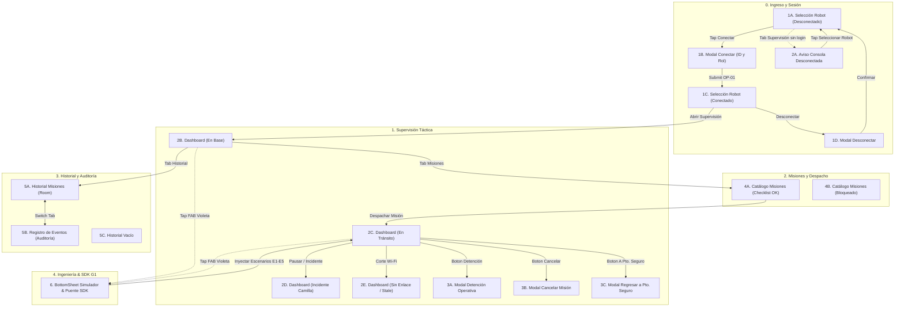

# 🎨 Master Prompt para Google Stitch — MediBot G1: Flujo Completo de Pantallas y Figma UX/UI

Este documento contiene la especificación exhaustiva y el **prompt maestro para Google Stitch** (y herramientas de generación UI a Figma), contemplando **todas las pantallas, estados, diálogos modales, avisos condicionales y el grafo de navegación interactivo (User Flow)** del proyecto **MediBot G1**.

---

## 📋 Cómo usar este prompt en Stitch de Google

1. Abrí **Google Stitch** (o el generador Figma con IA).
2. Seleccioná modo: **Multi-Screen Flow / App Journey** con viewport **Android Mobile (412 x 915 dp)**.
3. Copiá y pegá el contenido completo dentro del bloque **[PROMPT MAESTRO PARA STITCH: FLUJO COMPLETO]**.
4. Stitch generará el lienzo completo con:
   - Todas las pantallas en su posición dentro del flujo.
   - Las conexiones interactivas (flechas de navegación y prototipado).
   - Los diálogos modales y bottom sheets superpuestos.
   - Todos los componentes con Auto Layout y tokens de diseño exactos.

---

```markdown
# [PROMPT MAESTRO PARA STITCH: FLUJO COMPLETO]

Generate a comprehensive, pixel-perfect, multi-screen interactive mobile app flow in Figma for "MediBot G1", an autonomous humanoid robot (Unitree G1 EDU) supervision and command HMI/HRI application for hospital logistics.

---

## 1. DESIGN SYSTEM & DESIGN TOKENS

### Visual Aesthetics:
- **Theme:** Dark Medical-Tech / Tactical Autonomous Robotics
- **Palette Tokens (Strict Hex):**
  - Background: `#0B0F19` (Deep dark navy-black)
  - Card/Surface Primary: `#141B2D` (Clinical dark slate blue)
  - Card/Surface Variant: `#1A2332` (Elevated dark container)
  - On-Background (Primary Text): `#E0E0E0` (High-contrast pure light gray)
  - On-Surface (Secondary Text): `#B0BEC5` (Muted clinical blue-gray)
  - Accent Primary (Neon Cyan): `#00F5D4` (Telemetry readouts, primary buttons, active tabs)
  - Terminal Green (Success / Online): `#00E676` (Normal status, confirmed actions, verified checklist)
  - Warning Amber (Attention / Stale): `#FFAB00` (Degraded link, pause button, stale telemetry, warnings)
  - Critical Red (Emergency / Danger): `#FF1744` (Emergency Stop, critical alerts, rejected orders)
  - Electric Violet (Debug / NFC): `#7C4DFF` (Floating engineering button, tamper alert scenario)
  - Stale Gray: `#546E7A` (Disconnected states, inactive radio buttons)
  - Card Border Normal: `1px solid #1E3A5F`
  - Card Border Warning: `1px solid #FFAB00`
  - Card Border Critical: `1px solid #FF1744`
  - Card Border Stale: `1px solid #546E7A`
- **Device Viewport:** Mobile Portrait (412 x 915 px, Android Material 3).
- **Persistent Bottom Nav:** 4 Tabs (Robot, Supervisión, Misiones, Historial) + Floating Action Button (FAB) `#7C4DFF`.

---

## 2. COMPLETE SCREEN INVENTORY (ALL APP SCREENS & STATES)

### [PANTALLA 1A] Selección de Robot — Consola Desconectada (Estado Inicial)
- **Ruta:** `/robot`
- **Header:** Title "MEDIBOT G1" in `#00F5D4` 24px Bold, Subtitle: "Logística hospitalaria autónoma • Selección de robot".
- **Banner de Estado:** Rounded 12dp, Background `rgba(84,110,122,0.12)`, Border `1px solid #546E7A`. Icon `link_off` in StaleGray. Text: "Consola desconectada: seleccione un robot disponible y conéctese."
- **Sección: FLOTA DEL HOSPITAL (3 ROBOTS):**
  - **Item 1 (Seleccionado):** MediBot 1 (`G1-EDU-MED01`). Border `2px solid #00F5D4`, Background `#1A2332`. Icon `smart_toy` in `#00E676`. Ubicación: "Base de carga · Laboratorio Central (PB)". Nota: "Disponible (robot simulado)" in `#00F5D4`. Radio button marcado en Cyan.
  - **Item 2 (Inactivo):** MediBot 2 (`G1-EDU-MED02`). Opacidad 60%, Border `1px solid #1E3A5F`. Ubicación: "Taller técnico (PB)". Nota: "En mantenimiento: recambio de manos Dex3-1" in `#546E7A`. Radio desmarcado.
  - **Item 3 (Inactivo):** MediBot 3 (`G1-EDU-MED03`). Opacidad 60%. Ubicación: "Bahía de espera (Piso 2)". Nota: "Fuera de servicio: recalibración del LiDAR".
- **Ficha Técnica del Robot Seleccionado:**
  - Container `#141B2D` con borde `1.5px solid rgba(0,245,212,0.6)`.
  - Título: "UNITREE G1 EDU · G1-EDU-MED01".
  - Filas de especificaciones técnicas: LiDAR Livox Mid-360, Cámara Intel RealSense D435i, Manos Unitree Dex3-1, Cápsula Peltier 2–6 °C, Locomoción bípeda 0.8 m/s máx.
  - Botón Primario: "CONECTAR CONSOLA" (Height 48dp, Background `#00F5D4`, Text `#0B0F19` Bold).
- **Tarjeta de Infraestructura del Recorrido:**
  - Especificaciones: Ascensor PB-P2 (botonera 1.15m), Puerta cortafuego (picaporte 1.00m), Puntos NFC en Lab y UTI.

---

### [MODAL 1B] Diálogo: Conectar Consola (ConnectConsoleDialog)
- **Disparador:** Tocar "CONECTAR CONSOLA" en Pantalla 1A.
- **Tipo:** Modal AlertDialog con esquinas redondeadas 16dp, Background `#141B2D`.
- **Título:** "Conectar a MediBot 1" en `#00F5D4` Bold.
- **Campos:**
  - Input: `OutlinedTextField` con etiqueta "ID de operador / legajo", placeholder "Ej.: OP-LAB-04", texto ingresado "OP-01" en `#E0E0E0`, borde `#00F5D4`.
  - Texto de apoyo: "Queda registrado en la auditoría de cada orden."
  - Selector de Rol:
    - [◉] **Operador:** "Supervisa y emite órdenes al robot." (Radio activo en Cyan).
    - [○] **Supervisor:** "Solo observa: no puede emitir órdenes."
- **Botones de acción:**
  - "CONECTAR" (Filled `#00F5D4`, texto dark).
  - "DESCARTAR" (Outlined `#B0BEC5`).

---

### [PANTALLA 1C] Selección de Robot — Consola Conectada
- **Ruta:** `/robot` (tras conectar sesión exitosa).
- **Banner de Estado (Verde):** Background `rgba(0,230,118,0.12)`, Border `1px solid #00E676`. Icon `link` en `#00E676`. Text: "Consola conectada a MediBot 1 · OP-01 (Operador) · enlace ONLINE".
- **Ficha Técnica Actualizada:**
  - Mini stats en 2 columnas: BATERÍA 85% (`#00E676`) | ESTADO En Base (Reposo) (`#00F5D4`).
  - Botón Primario: "ABRIR PANEL DE SUPERVISIÓN" (Background `#00F5D4`, Icon `dashboard`, Text `#0B0F19` Bold).
  - Botón Secundario: "DESCONECTAR CONSOLA" (Outlined `#FFAB00`, Icon `link_off`).

---

### [MODAL 1D] Diálogo: Confirmar Desconexión (ConfirmActionDialog)
- **Disparador:** Tocar "DESCONECTAR CONSOLA" en Pantalla 1C.
- **Título:** "¿Desconectar la consola?" en `#FFAB00` Bold.
- **Mensaje:** "Dejará de recibir telemetría y no podrá emitir órdenes hasta volver a conectarse." (o si hay misión activa: "Hay una misión en curso. El robot continuará de forma autónoma sin supervisión remota").
- **Botones:** "DESCONECTAR" (Filled `#FFAB00`, texto dark) y "DESCARTAR".

---

### [PANTALLA 2A] Aviso: Consola Desconectada (ConsoleDisconnectedNotice)
- **Ruta:** `/dashboard` o `/missions` cuando no hay sesión conectada.
- **Layout:** Pantalla centrada con card oscura `#141B2D`, borde `1px solid #546E7A`.
- **Icono:** `link_off` grande (48dp) en `StaleGray` (`#546E7A`).
- **Título:** "CONSOLA DESCONECTADA" en 20px Bold.
- **Mensaje:** "No hay un robot seleccionado. Sin conexión no se muestran datos en vivo ni se pueden emitir órdenes."
- **Botón de Acción:** "SELECCIONAR ROBOT" (Background `#00F5D4`, Text `#0B0F19` Bold) -> Redirige a `/robot`.

---

### [PANTALLA 2B] Supervisión Táctica — Estado Normal en Base (DashboardScreen - Idle)
- **Ruta:** `/dashboard`
- **Encabezado Superior de Conectividad:**
  - Card `#141B2D` con borde `#1E3A5F`.
  - Fila 1: Punto verde brillante (`#00E676`) + "ONLINE (42ms / -35dBm)" | Chip cian: "G1 SDK CONECTADO" | Botón rojo "DETENCIÓN" (48dp min-height).
  - Fila 2: "Última actualización: 17:25:00 · hace 1 s" | "Sesión: OP-01 · Operador · MediBot 1" en `#00F5D4`.
  - Fila 3: Icono `battery_charging_full` en `#00E676`, "BATERÍA: 85% (~102 min)" | "TEMP PACK: 28.5°C".
- **Mapa Esquemático Táctico 2D (PB y Piso 2):**
  - Diagrama de 6 nodos: [PB - Base de Carga (Robot aquí con icono bípedo y pulso cian)] ── [PB - Lab Central] ── [PB - Puerta Cortafuego] ── [Ascensor Hospitalario] ── [Piso 2 - Receso Seguro] ── [Piso 2 - Enfermería UTI].
  - Barra de progreso inferior en 0%. Label: "Robot en reposo en base".
- **Sección: TELEMETRÍA CRÍTICA DE CARGA MÉDICA (2 Columnas + 1 Ancha):**
  - Card 1: "Temperatura Cápsula" ➔ Readout: `4.0 °C` (`#00F5D4`), Subtítulo: "Reposo 2–6 °C", Icono `thermostat`.
  - Card 2: "Estabilidad Tubos" ➔ Readout: `0.05 G` (`#00F5D4`), Subtítulo: "Normal < 0.30 G", Icono `vibration`.
  - Card 3 (Ancho completo): "Cerradura Inteligente NFC" ➔ Readout: "Sellado y Bloqueado", Subtítulo: "Custodia sellada por cerrojo solenoide", Icono `lock` en verde.
- **Sección: ESTADO CINEMÁTICO E INTERACCIÓN HRI (2 Columnas + 1 Ancha):**
  - Card 4: "Estado Operativo" ➔ Readout: "En Base (Reposo)", Subtítulo: "Postura: Bípedo - De Pie".
  - Card 5: "Velocidad Bípeda" ➔ Readout: `0.00 m/s`, Subtítulo: "Límite: 0.80 m/s".
  - Card 6 (Voz HRI y LED): Aro circular de 32dp con glow Cian, Icono `lightbulb` cian, Label "MENSAJE DE VOZ HRI", Texto: `"Sistema listo en base de carga."`.
- **Consola de Control Operativo:**
  - Aviso amarillo: "AVISO DE SEGURIDAD: las órdenes son comandos de software. No reemplazan la parada física de emergencia."
  - Botones (2x2):
    - [ PAUSAR ] (Deshabilitado en gris)
    - [ REANUDAR ] (Deshabilitado en gris)
    - [ A PTO. SEGURO ] (Deshabilitado en gris)
    - [ CANCELAR ] (Deshabilitado en gris)

---

### [PANTALLA 2C] Supervisión Táctica — Misión en Tránsito (DashboardScreen - Executing)
- **Ruta:** `/dashboard` (mientras traslada sangre hacia la UTI).
- **Mapa Táctico:**
  - Nodo activo: `SAFE_POINT_P2` (Piso 2) con halo cian y velocidad 0.6 m/s.
  - Barra de progreso: 75% cian. Label: "Destino: UTI Piso 2 (75%)".
- **Telemetría en Tránsito:**
  - Cápsula: `4.1 °C` (Normal, dentro del rango 2–6 °C).
  - Estabilidad: `0.14 G` (Vibración suave).
  - Velocidad: `0.60 m/s`.
  - Voz HRI: `"Unidad médica en tránsito. Conserve su derecha."` con LED Cian vibrante.
- **Consola de Comandos Habilitada:**
  - [ PAUSAR ] en `#FFAB00` (Habilitado).
  - [ A PTO. SEGURO ] en `#00F5D4` (Habilitado).
  - [ CANCELAR ] en `#FF1744` (Habilitado).

---

### [PANTALLA 2D] Supervisión Táctica — Incidente en Pasillo (Obstáculo Frontal)
- **Ruta:** `/dashboard` (Escenario E4).
- **Banner de Alerta Crítica (Rojo/Ámbar):**
  - Icono `warning` rojo. Título: "Obstáculo en pasillo (Camilla a 0.35m)".
  - Mensaje: "Camilla bloqueando el paso en PB - Puerta Cortafuego. Decisión requerida: esperar y reanudar, o desviar a punto seguro."
  - Botón: "RECONOCER (ACK)" en `#FF1744`.
- **Mapa Táctico:** Nodo Puerta Cortafuego parpadeando en rojo.
- **Cinemática:** Estado "Bloqueado por Incidente", velocidad `0.00 m/s`, LED Rojo `#FF1744`.
- **Consola de Comandos:**
  - [ REANUDAR ] deshabilitado hasta reconocer la alerta y despejar el pasillo.
  - [ A PTO. SEGURO ] habilitado para desviar a la base.

---

### [PANTALLA 2E] Supervisión Táctica — Telemetría Antigua / Desconexión
- **Ruta:** `/dashboard` (Escenario E3).
- **Encabezado:** Badge Rojo "SIN ENLACE", Badge Ámbar "DATOS ANTIGUOS (hace 12s)".
- **Contenido General:** Todas las tarjetas de telemetría y mapa atenuadas al 55% de opacidad (efecto visual de desconexión sin borrar el último estado conocido).
- **Banner de Feedback de Orden:** Rojo "SIN RESPUESTA: CANCEL_MISSION no fue confirmada en 2500 ms. No se sabe si el robot la ejecutó: verifique la telemetría."

---

### [MODAL 3A] Diálogo: Confirmar Detención Operativa (ConfirmActionDialog)
- **Disparador:** Tocar el botón rojo permanente "DETENCIÓN".
- **Título:** "CONFIRMAR DETENCIÓN OPERATIVA" en `#FF1744` Bold.
- **Mensaje:** "El robot frena de inmediato y queda inmóvil. Es un comando de software: no reemplaza la parada física de emergencia."
- **Botones:** "DETENER AHORA" (Filled `#FF1744`) y "DESCARTAR".

---

### [MODAL 3B] Diálogo: Confirmar Cancelar Misión
- **Disparador:** Tocar "CANCELAR" en el panel de comandos.
- **Título:** "¿Cancelar la misión?" en `#FF1744` Bold.
- **Mensaje:** "El traslado se aborta y la carga no se entrega. La misión quedará registrada como CANCELADA y el robot regresará a la base."
- **Botones:** "CANCELAR MISIÓN" (Filled `#FF1744`) y "DESCARTAR".

---

### [MODAL 3C] Diálogo: Confirmar Regreso a Punto Seguro
- **Disparador:** Tocar "A PTO. SEGURO".
- **Título:** "¿Regresar a punto seguro?" en `#FFAB00` Bold.
- **Mensaje:** "El robot interrumpe la ruta y se dirige al punto seguro más cercano (Base en PB o Bahía en Piso 2). La carga no se entregará."
- **Botones:** "REGRESAR" (Filled `#FFAB00`) y "DESCARTAR".

---

### [PANTALLA 4A] Catálogo de Misiones Hospitalarias (MissionsScreen - Lista para Despachar)
- **Ruta:** `/missions`
- **Header:** "CATÁLOGO DE MISIONES HOSPITALARIAS" + Subtítulo clínico.
- **Checklist de Pre-condiciones de Despacho (Verde):**
  - Header: "CHECKLIST DE PRE-CONDICIONES DE DESPACHO" | Badge "TODO LISTO" en `#00E676`.
  - [✔] Robot en reposo (base o punto seguro) ➔ `En Base (Reposo)`
  - [✔] Batería ≥ 20% ➔ `85%`
  - [✔] Cápsula sellada ➔ `Sellado y Bloqueado`
  - [✔] Cápsula estable en reposo (≤ 6.0 °C) ➔ `4.0 °C`
  - [✔] Enlace en línea con datos frescos ➔ `ONLINE`
- **Lista de Misiones Disponibles (3 Cards):**
  - **Misión 1 (Seleccionada con borde cian de 2dp):**
    - Título: "MED-01-GAS: Urgencia: Gases en Sangre → UTI", Badge: `URGENTE` (`#FF1744`).
    - Descripción: "Transporte prioritario de muestra arterial heparinizada desde el Laboratorio Central hasta el puesto de Terapia Intensiva."
    - Footer: "Ruta: PB - Lab Central ➔ Piso 2 - Enfermería UTI" | "Cápsula 2–6 °C · Vib. máx 0.30 G".
  - **Misión 2:** "MED-02-HEM: Hemoterapia: 2 Unidades Plasma → Quirófano", Badge `URGENTE`.
  - **Misión 3:** "MED-03-FAR: Farmacia: Medicación Controlada → Piso 2", Badge `ESTÁNDAR` (`#00F5D4`).
- **Botón de Despacho:**
  - Altura 50dp, Background `#00F5D4`, Icon `send`, Texto: "DESPACHAR: Urgencia: Gases en Sangre → UTI" en `#0B0F19` Bold.

---

### [PANTALLA 4B] Catálogo de Misiones — Checklist Bloqueado (Precondiciones no cumplidas)
- **Ruta:** `/missions` (cuando la batería es <20% o el compartimento está abierto).
- **Checklist:**
  - Badge: "BLOQUEADO" en `#FFAB00`.
  - [✖] Batería ≥ 20% ➔ `14%` (Icono rojo `cancel`).
- **Botón de Despacho:** Deshabilitado en fondo `#1A2332`, texto en `StaleGray`.

---

### [PANTALLA 5A] Historial y Auditoría — Pestaña Misiones Ejecutadas (HistoryScreen - Missions)
- **Ruta:** `/history` (Tab 0 seleccionado)
- **Header:** "HISTORIAL Y AUDITORÍA (ROOM)" | "Solo lectura · persistencia local (Room)".
- **Tabs Selector:** [ MISIONES EJECUTADAS (Activo en cian) ] | [ AUDITORÍA / EVENTOS ]
- **Lista de Misiones Persistidas:**
  - **Card 1 (Completada):**
    - Título: "Urgencia: Gases en Sangre → UTI", Badge: `COMPLETADA` en `#00E676`.
    - Trayecto: "PB - Laboratorio Bioquímico ➔ Piso 2 - Enfermería Terapia Intensiva".
    - Nota clínica: "Entrega validada por NFC en destino."
    - Metadatos: "MED-01-GAS-7F3A · Fin 17:15:30 (125s) | Bat. 78% · Tmáx 4.3°C · Vmáx 0.16G".
  - **Card 2 (Cancelada):**
    - Título: "Hemoterapia: 2 Unidades Plasma → Quirófano", Badge: `CANCELADA` en `#FFAB00`.
    - Nota: "Cancelada por el operador en PB - Puerta Cortafuego."
    - Metadatos: "MED-02-HEM-9A21 · Fin 16:40:12 (45s) | Bat. 81% · Tmáx 3.8°C · Vmáx 0.22G".

---

### [PANTALLA 5B] Historial y Auditoría — Pestaña Registro de Eventos (HistoryScreen - Events)
- **Ruta:** `/history` (Tab 1 seleccionado)
- **Lista de Auditoría Cronológica:**
  - **Item 1 (Crítico):** Punto rojo de 8dp, Título: "Obstáculo en pasillo" | Hora: `17:12:00` | Detalle: "Camilla bloqueando el paso frontal a 0.35 m en PB - Puerta Cortafuego" | Chip: `ALERT • CRITICAL • OP-01`.
  - **Item 2 (Info):** Punto cian, Título: "Consola conectada (Operador)" | Hora: `17:00:10` | Detalle: "OP-01 inició la supervisión de MediBot 1 con rol operador." | Chip: `SYSTEM • INFO • OP-01`.
  - **Item 3 (Advertencia):** Punto ámbar, Título: "Misión cancelada" | Hora: `16:39:55` | Detalle: "Orden CANCEL_MISSION confirmada por el operador." | Chip: `COMMAND • WARNING • OP-01`.

---

### [PANTALLA 5C] Historial Vacío (Empty State)
- **Ruta:** `/history` (cuando la base de datos está limpia).
- **Centro:** Icono `folder_open` en `StaleGray` (48dp).
- **Texto:** "No hay misiones persistidas en Room. Ejecute un escenario o cargue datos de ejemplo desde el panel de ingeniería."

---

### [MODAL 6] Panel de Ingeniería y Puente SDK G1 (SimulatorControlBottomSheet)
- **Disparador:** Tocar el botón flotante violeta (`bug_report`) en cualquier pantalla.
- **Tipo:** Modal Bottom Sheet desplegable con drag handle superior.
- **Header:** Icono `bug_report` en `#7C4DFF` + "INYECTOR DE ESCENARIOS DE SIMULACIÓN" | "Panel de Pruebas Unitree G1 EDU (Modo Ingeniero/Debug)".
- **Card: PUENTE SDK G1 (FASTAPI):**
  - Header: Icono `sensors` verde + "PUENTE SDK G1 (FASTAPI)" | "Conectado a FastAPI (:8000)" | Switch activado en verde.
  - Input: URL `http://10.0.2.2:8000` con botones preset: [ Emulador (10.0.2.2) ] [ Localhost (127.0.0.1) ].
  - Sub-sección: "GESTOS SOCIALES HRI (SDK G1):"
  - 3 Botones de acción directa:
    - [ 👋 Saludar (WaveHand) ] (Borde Cian)
    - [ ✋ High Five (Action 18) ] (Borde Verde)
    - [ 🤚 Liberar (Action 99) ] (Borde Ámbar)
- **Switch de Política:** "FORZAR RECHAZO DEL PRÓXIMO COMANDO" (Demuestra estado REJECTED).
- **Los 5 Escenarios Obligatorios de Prueba:**
  - [E1] Misión Normal (Lab ➔ UTI) — Borde Verde
  - [E2] Batería Baja (19% ➔ retorno forzado 15%) — Borde Ámbar
  - [E3] Desconexión Wi-Fi 6 (Stale Telemetry) — Borde Rojo
  - [E4] Incidente en Pasillo (Camilla a 0.35m) — Borde Rojo
  - [E5] Cadena de Frío / Tamper (8.4°C) — Borde Violeta
- **Acciones Presenciales (Condicionales):**
  - [ REARME PRESENCIAL ] (Botón ámbar con icono `build`, visible solo tras Detención Operativa).
  - [ CAMBIO DE BATERÍA PRESENCIAL ] (Botón ámbar con icono `battery_charging_full`, visible solo tras Agachado Seguro).
- **Herramientas de Auditoría:**
  - Botón: "REINICIAR SIMULACIÓN (ROBOT EN BASE)" (Outlined).
  - Botón: "DATOS DE EJEMPLO" (Cian) y "BORRAR HISTORIAL" (Rojo con confirmación modal).

---

## 3. INTERACTIVE SCREEN FLOW GRAPH (CONEXIONES Y PROTOTIPADO PARA STITCH)

Render the complete interactive prototype navigation wires:

1. **Flujo de Conexión Inicial:**
   `[Pantalla 1A: RobotSelection Desconectado]`
   ──(Tap "CONECTAR CONSOLA")──> `[Modal 1B: ConnectConsoleDialog]`
   ──(Tap "CONECTAR" con OP-01)──> `[Pantalla 1C: RobotSelection Conectado]`
   ──(Tap "ABRIR PANEL DE SUPERVISIÓN")──> `[Pantalla 2B: Dashboard Normal]`

2. **Flujo de Desconexión:**
   `[Pantalla 1C: RobotSelection Conectado]`
   ──(Tap "DESCONECTAR CONSOLA")──> `[Modal 1D: Confirmación Desconectar]`
   ──(Tap "DESCONECTAR")──> `[Pantalla 1A: RobotSelection Desconectado]`

3. **Flujo de Acceso no Autorizado / Gating:**
   `[Pantalla 1A: Desconectado]`
   ──(Tap Bottom Tab "Supervisión")──> `[Pantalla 2A: ConsoleDisconnectedNotice]`
   ──(Tap "SELECCIONAR ROBOT")──> `[Pantalla 1A: RobotSelection]`

4. **Flujo de Despacho de Misión:**
   `[Pantalla 2B: Dashboard Normal]`
   ──(Tap Bottom Tab "Misiones")──> `[Pantalla 4A: Missions Catalog]`
   ──(Tap "DESPACHAR: Gases en Sangre")──> `[Pantalla 2C: Dashboard En Tránsito]`

5. **Flujo de Emergencia y Confirmación:**
   `[Cualquier Pantalla]`
   ──(Tap botón rojo "DETENCIÓN")──> `[Modal 3A: Confirmar Detención]`
   ──(Tap "DETENER AHORA")──> `[Pantalla 2B en estado EMERGENCY_STOPPED]`
   ──(Tap FAB Violeta)──> `[Modal 6: SimulatorSheet]`
   ──(Tap "REARME PRESENCIAL")──> `[Pantalla 2B en estado PAUSED]`
   ──(Tap "REANUDAR")──> `[Pantalla 2C: En Tránsito]`

6. **Flujo de Cancelación y Desvío:**
   `[Pantalla 2C: En Tránsito]`
   ──(Tap "CANCELAR")──> `[Modal 3B: Confirmar Cancelar]`
   ──(Tap "CANCELAR MISIÓN")──> `[Pantalla 2B con robot regresando a Base]`

7. **Flujo de Auditoría:**
   `[Cualquier Pantalla]`
   ──(Tap Bottom Tab "Historial")──> `[Pantalla 5A: Misiones Ejecutadas]`
   ──(Tap Tab "Auditoría/Eventos")──> `[Pantalla 5B: Log de Eventos]`

8. **Flujo del Panel de Ingeniería y Puente SDK:**
   `[Cualquier Pantalla]`
   ──(Tap FAB Violeta `bug_report`)──> `[Modal 6: SimulatorSheet]`
   ──(Tap "Saludar" o "High Five")──> Dispara animación de gesto y actualiza la consola web FastAPI.
```

---

## 🗺️ Matriz Visual del Flujo de Pantallas


